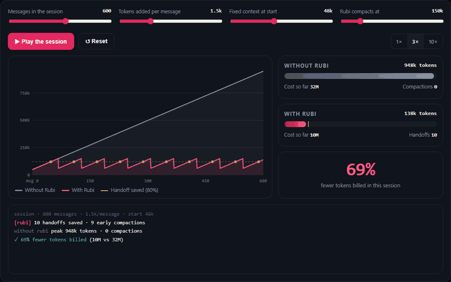
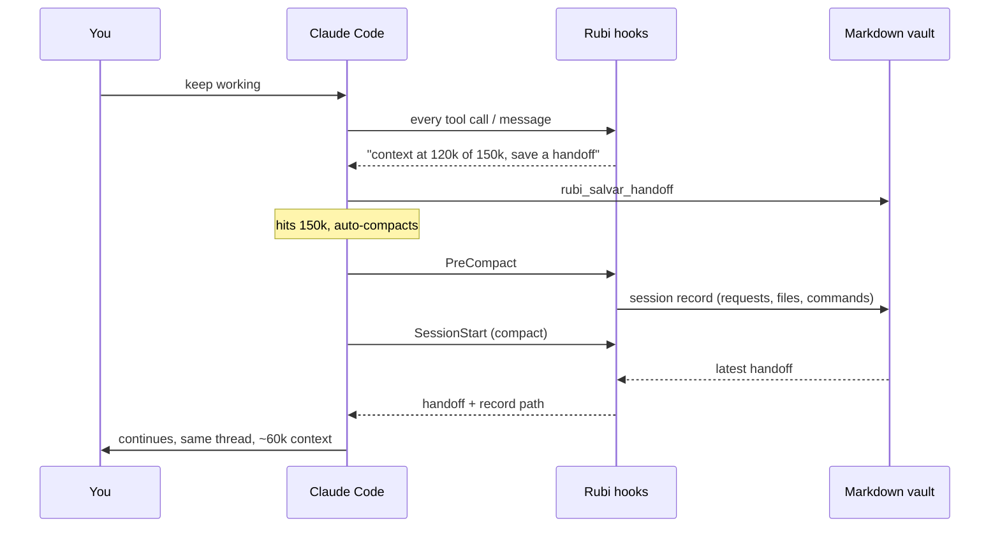

<p align="center">
  
</p>

<p align="center">
  <a href="https://yuribedran.github.io/rubi/"><b>Live demo</b></a> ·
  <a href="#install">Install</a> ·
  <a href="#how-it-works">How it works</a> ·
  <a href="#token-x-ray">Token X-ray</a> ·
  <a href="#faq">FAQ</a>
</p>

<p align="center">
  
  
  
  
  
  
</p>

**Rubi keeps your Claude sessions short on its own, without losing the thread.** It compacts early, saves a handoff before every compaction and restores it right after. It keeps what matters in a markdown vault you can open in Obsidian, and it shows you exactly where your tokens go.

No server. No database. No dependencies beyond Node.

---

## Why

Every message you send re-sends the **whole conversation**. Prompt caching makes that re-read cheaper, but it still happens on every turn. So cost grows with session length: message #500 pays for the 499 before it.

We ran Rubi's X-ray on 30 days of real Claude Code usage (284 sessions):

| What the X-ray found | |
|---|---|
| Share of cost that was just **re-reading context** (cache reads) | **71%** |
| Share of cost from sessions that grew past **150k tokens** | **97%** |
| Sessions that crept up to **~1 million** tokens | **68** |
| Context loaded **before the first message** (median) | **48k** |
| Cache hit rate | 99% (the cache was fine; the sessions were just too long) |

Simulating the same month with Rubi (compact at 150k, handoff preserved) cut **about one third of the total**. A single long session saves much more, about **two thirds**:

<p align="center">
  <a href="https://yuribedran.github.io/rubi/"></a>
  <br><sub><a href="https://yuribedran.github.io/rubi/">Open the interactive demo</a> and drag the sliders to match how you work.</sub>
</p>

---

## How it works

<p align="center">
  
</p>

1. **Compact early.** Claude Code compacts on its own at **150k** instead of near **1M**. You never type `/clear`.
2. **Meter.** At 80% of the window, a hook tells Claude to write a **handoff**: goal, current state, decisions, key files, next step.
3. **Record.** Right before compaction, Rubi saves what's about to disappear (your requests, files changed, commands run) to the vault. No LLM involved, just extraction.
4. **Restore.** Right after compaction, the handoff is injected back. Claude carries on from **~60k** tokens instead of 500k+, with the details the generic summary would have lost.



### Inside your terminal

<p align="center">
  
  <br><sub>Illustrative session.</sub>
</p>

---

## Install

You need **Node 18+**.

### Claude Code (terminal, VS Code, JetBrains)

**1. Add and install the plugin** inside Claude Code:

```text
/plugin marketplace add YURIBEDRAN/rubi
/plugin install rubi@rubi
```

**2. Turn on early compaction** and choose where the vault lives:

```bash
git clone https://github.com/YURIBEDRAN/rubi && cd rubi
node scripts/instalar.mjs
```

The installer asks for a vault folder (default `~/rubi-vault`) and a compaction threshold (default `150000`, minimum `100000`). It writes `CLAUDE_CODE_AUTO_COMPACT_WINDOW` into the `env` block of `~/.claude/settings.json` and backs up the original to `settings.json.bak-rubi`.

- **Undo:** `node scripts/instalar.mjs --desfazer`
- **Try without installing:** `claude --plugin-dir path/to/rubi`
- **Skip step 2:** Rubi still works, but Claude Code only compacts near the model's limit. The meter warns at 120k and suggests `/compact`.

### Claude Desktop

1. Download **`rubi.mcpb`** from [Releases](https://github.com/YURIBEDRAN/rubi/releases/latest).
2. Open it with Claude Desktop (or drag it into **Settings → Extensions**) and pick a vault folder. An existing Obsidian vault works.
3. Also upload the **`rubi.zip`** skill (next section). It teaches Claude when a chat has grown too long.

### claude.ai and mobile

The web and mobile apps have no hooks, so the automatic part becomes behavior: the skill teaches Claude to notice a long chat, offer a handoff and continue in a fresh one.

**Skill only (zero setup)**

1. Download **`rubi.zip`** from [Releases](https://github.com/YURIBEDRAN/rubi/releases/latest).
2. On claude.ai go to **Settings → Capabilities → Skills → Upload skill**. Skills must be enabled on your plan.
3. When a chat gets long, Claude hands you a short summary block to paste into a new chat.

**Skill + connector (memory saved for real, on your phone too)**

Run the same MCP server in HTTP mode on a server you control:

```bash
export RUBI_TOKEN=$(openssl rand -hex 24)   # secret, goes in the URL
export RUBI_VAULT=/srv/rubi-vault
node scripts/mcp-server.mjs --http --porta 8787
```

It binds to `127.0.0.1` only. Put HTTPS in front, for example with Caddy:

```text
rubi.yourdomain.com {
  reverse_proxy 127.0.0.1:8787
}
```

Then on claude.ai: **Settings → Connectors → Add custom connector** with the URL `https://rubi.yourdomain.com/mcp/<RUBI_TOKEN>`. Connectors added on the web also show up in the mobile app.

> [!WARNING]
> Anyone with that URL can read and write your memory. Treat it like a password, keep secrets out of the vault and run the server as an unprivileged user.

---

## What you get

| Piece | What it does | Where |
|---|---|---|
| **Early compaction** | Claude Code compacts at 150k (configurable) instead of near 1M | `CLAUDE_CODE_AUTO_COMPACT_WINDOW` |
| **Meter** | Reads the real context size on every message and tool call, asks for a handoff before compaction | `UserPromptSubmit`, `PostToolUse` hooks |
| **Session record** | Saves requests, changed files, commands and the last reply right before compaction | `PreCompact` hook |
| **Restore** | Injects the handoff after compaction or `/clear`. On a fresh start, only a short index | `SessionStart` hook |
| **Read guard** | Blocks reading a huge file in full (Read or `cat`) once and points to Grep or `offset/limit`. Repeat the same call and it goes through | `PreToolUse` hook |
| **Vault** | Plain markdown, one folder per project, `[[wiki-links]]` for Obsidian | MCP server `rubi` |
| **Token X-ray** | Where your tokens went: cost breakdown, priciest sessions, heaviest tools, cache misses, savings simulation | `/rubi:raio-x` |
| **Fixed-context audit** | What loads into every session (CLAUDE.md, memory, skills, MCP) and what to trim | `/rubi:raio-x` |

<details>
<summary><b>MCP tools</b></summary>

| Tool | Purpose |
|---|---|
| `rubi_buscar` | Search notes, handoffs and records (accent-insensitive, returns short snippets) |
| `rubi_ler` | Open a vault file (cannot escape the vault folder) |
| `rubi_salvar_nota` | Durable knowledge: decisions, maps, gotchas (`substituir` = replace, `anexar` = append) |
| `rubi_salvar_handoff` | Save "where we left off" |
| `rubi_ultimo_handoff` | Fetch the latest handoff for a project |
| `rubi_projetos` | List projects in the vault |
| `rubi_raio_x` / `rubi_auditar` | Token diagnostics (Claude Code only) |

</details>

<details>
<summary><b>Slash commands (skills)</b></summary>

- `/rubi:handoff`: save where you left off right now (the meter triggers it automatically).
- `/rubi:memoria <topic>`: search the project memory. Also teaches Claude what is worth saving.
- `/rubi:raio-x`: token diagnostics with the three changes that would save the most.

</details>

---

## The vault

```text
rubi-vault/
├── LEIA-ME.md
└── my-app/
    ├── _indice.md                          links to everything (generated)
    ├── notas/decisions.md                  durable knowledge, edit freely
    ├── handoffs/2026-10-17-1530.md         "where we left off"
    └── sessoes/2026-10-17-1531-8ab90355.md automatic pre-compaction record
```

The project name is the git root folder, or the current folder. Everything is markdown with frontmatter, so you can open it in Obsidian, `grep` it, edit it by hand or version it with git.

---

## Token X-ray

```bash
node scripts/raio-x.mjs --dias 30          # where your tokens went
node scripts/auditar.mjs <project-folder>  # what loads into every session
```

```text
=== RAIO-X (30 dias, 284 sessões) ===
Composição do custo:
  write1h   109.7M tokens  -> 17% do custo
  read     9212.2M tokens  -> 71% do custo
  output     25.2M tokens  -> 10% do custo
Pico de contexto por sessão: <50k 5 | 50-150k 128 | 150-400k 83 | >400k 68
Sessões que passaram de 150k respondem por 97% do custo

Simulação de handoff automático:
  limite 150k: 695 trocas de janela, economia ~37% do custo total
```

Costs are shown in **input-token equivalents**: cache read 0.1×, cache write 1.25× (5 min) or 2× (1 h), output 5×. These are Anthropic's price ratios, so the numbers hold for any model or plan without guessing dollar amounts.

A typical audit finding: an 18k-token `CLAUDE.md` re-read on every single message, or 50k tokens of tool definitions from MCP servers the project never uses.

---

## Configuration

`~/.rubi/config.json`

```json
{
  "vault": "D:/Notes/rubi-vault",
  "janela": 150000,
  "avisoPct": 0.8,
  "guarda": { "ativa": true, "maxLinhas": 800, "maxBytes": 80000 }
}
```

| Key | Default | Meaning |
|---|---|---|
| `vault` | `~/rubi-vault` | Vault folder (or `RUBI_VAULT`) |
| `janela` | `150000` | Reference window. `CLAUDE_CODE_AUTO_COMPACT_WINDOW` wins when set |
| `avisoPct` | `0.8` | Fraction of the window at which the meter asks for a handoff |
| `guarda.maxLinhas` / `maxBytes` | `800` / `80000` | When reading a whole file gets blocked |
| `guarda.ativa` | `true` | Turn the read guard off |

Per-session state (what was already warned or allowed) lives in `~/.rubi/estado/`.

---

## FAQ

<details>
<summary><b>Does Rubi send my data anywhere?</b></summary>

No. Hooks and the MCP server run locally and only read your Claude Code transcripts and write to your vault. The only network piece is the optional HTTP connector, which you host yourself.
</details>

<details>
<summary><b>Can a hook run <code>/clear</code> or <code>/compact</code>?</b></summary>

No, Claude Code doesn't allow that. Claude Code compacts by itself at the threshold you set. Rubi handles the before (handoff and record) and the after (restore).
</details>

<details>
<summary><b>Does it change Claude's compaction summary?</b></summary>

No, hooks can't edit it. That's why the handoff and the session record go to the vault and are injected right after compaction.
</details>

<details>
<summary><b>Why 150k?</b></summary>

It was the best point in the simulation over real usage. Compaction has its own cost (one call that reads the context to summarize it), so going much lower stops paying off. Claude Code's minimum is 100k.
</details>

<details>
<summary><b>The read guard blocked a file I really need.</b></summary>

Ask again. The guard blocks only the first full read of each big file per session, then lets the same call through.
</details>

<details>
<summary><b>Why are some names in Portuguese?</b></summary>

Rubi was born in Brazil. Tool names, folders and the messages Rubi sends to Claude are in Portuguese for now. Claude understands them either way. English names are on the roadmap.
</details>

---

## Roadmap

- **Knowledge graph:** automatic `[[links]]` between notes, files and concepts, search that expands to neighbors, backlinks and a real Obsidian graph view.
- English tool names and messages.
- Signed `.mcpb` releases.

## Development

```bash
npm test             # 9 tests: meter, compaction, guard, search, MCP stdio + HTTP
npm run empacotar    # builds dist/rubi.mcpb and dist/rubi.zip
claude plugin validate .
python docs/assets/build_svgs.py   # regenerates the README animations
```

```text
.claude-plugin/   plugin.json + marketplace.json
hooks/hooks.json  SessionStart, UserPromptSubmit, PostToolUse, PreCompact, PreToolUse
skills/           handoff, memoria, raio-x
scripts/
  hook.mjs        every hook (inicio | medidor | pre-compactar | guarda)
  mcp-server.mjs  MCP server (stdio + HTTP), zero dependencies
  raio-x.mjs      token X-ray from transcripts
  auditar.mjs     fixed-context audit
  instalar.mjs    vault + early compaction setup
  empacotar.mjs   builds the desktop and claude.ai packages
  lib/            config, vault, transcript parsing
app/
  desktop/manifest.json   Claude Desktop extension (.mcpb)
  claude-ai/rubi/         claude.ai skill
docs/             interactive demo (GitHub Pages) and README assets
```

Hooks never break a session: any error exits silently. Set `RUBI_DEBUG=1` to see it. The meter reads only the last 0.5 MB of the transcript and runs in about 0.1 s, even with 100+ MB transcripts.

## Credits

- The name comes from **Rubi**nger, and from the idea of keeping only what's precious.
- [akitaonrails/ai-memory](https://github.com/akitaonrails/ai-memory) for the idea of memory as a versionable markdown wiki fed by hooks.
- Built with Claude Code.

## License

MIT
