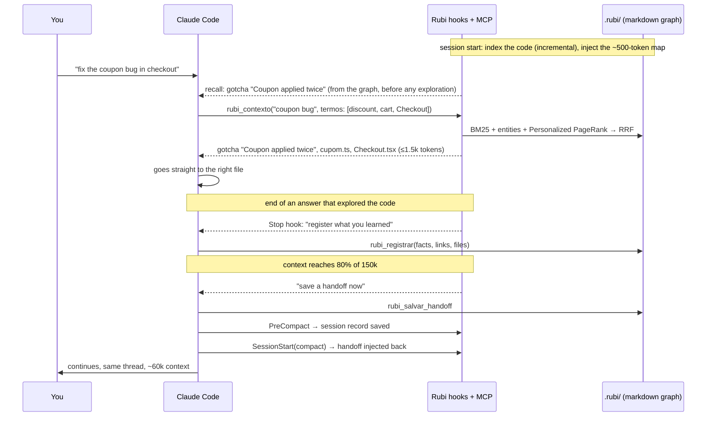

<p align="center">
  
</p>

<h3 align="center">A knowledge graph and context manager for AI coding agents.<br>Claude, Codex, Gemini, Cursor, Copilot and local models.<br>Shorter sessions, organized projects, fewer tokens.</h3>

<p align="center">
  <a href="https://huggingface.co/spaces/YuriBedran/rubi"><b>Check your usage</b></a> ·
  <a href="https://yuribedran.github.io/rubi/"><b>Live demo</b></a> ·
  <a href="#5-walkthrough-a-week-with-rubi">Walkthrough</a> ·
  <a href="#4-results">Results</a> ·
  <a href="#7-install"><b>Install &amp; test</b></a> ·
  <a href="#2-background">The theory</a>
</p>

<p align="center">
  
  
  
  
  
  <a href="https://huggingface.co/spaces/YuriBedran/rubi"></a>
  <a href="https://huggingface.co/datasets/YuriBedran/rubi-benchmark"></a>
  
  <a href="https://github.com/YURIBEDRAN/rubi/actions/workflows/testes.yml"></a>
  
</p>

---

## Abstract

AI coding assistants are billed for every token they read, and in a long conversation they re-read the whole history on every message. Analyzing **284 real Claude Code transcripts** (sessions and sub-agent runs), we found that **71% of the cost was spent re-reading context** and **97% came from sessions that grew past 150k tokens**.

**Rubi** attacks the problem from two sides:

1. **Keep sessions short without losing the thread.** It compacts early, saves a *handoff* before each compaction and restores it right after.
2. **Make the project easy to find your way around, so less reading is needed.** It builds a **map of the code** (imports and centrality via PageRank) and a **temporal knowledge graph** of decisions, bugs, gotchas and concepts. The graph is written by Claude itself, at the moment it already holds that knowledge in context, and searched with a hybrid of BM25, Personalized PageRank and Reciprocal Rank Fusion, within a token budget. Relevant knowledge is **recalled automatically** on every request, before Claude starts exploring.

Everything is plain markdown inside the project (`.rubi/`), opens as an Obsidian graph, and runs locally with zero dependencies. It was built for Claude Code and, because its core is a standard MCP server, it also runs in **Codex, Gemini CLI, Cursor, GitHub Copilot, Windsurf, Cline, OpenCode, Continue, Goose and Zed**, with hosted or **local models** ([see the table](#codex-gemini-cli-cursor-copilot-and-other-agents)).

**Results.** Four studies, reported as measured, including what did not work:

| Study | Result |
|---|---|
| Early compaction, replayed on 284 real transcripts | **≈37% lower total cost** (simulation on real context curves) |
| A/B benchmark, 90 sessions, reading a mature graph | **−37% steps, −37% context re-read, −17% time**; billed cost **−6%** in short cold-start sessions |
| Same, projected onto the real cost mix (71% cache reads) | **≈26% lower cost** (projection, not yet measured) |
| A/B benchmark, writing memory after every answer | **+15% cost** in short sessions, so the default was changed to write less often |
| Five more ideas, measured on top of early compaction | the fixed context is **13% of the cost** and is now diagnosed by the X-ray; shortening outputs and restarting after pauses add at most 1.5 points, so they stay off ([4.4](#44-study-3-other-savings-measured-before-building)) |
| Automatic graph built without any model (git co-change, file comments), 36 sessions | **−19% turns**, **−9.6% cost** against an empty memory, at zero tokens to build ([4.5](#45-study-4-savings-that-cost-no-tokens-84-sessions)) |

---

## Contents

1. [The problem: why long sessions get expensive](#1-the-problem-why-long-sessions-get-expensive)
2. [Background](#2-background)
3. [Design: how Rubi works](#3-design-how-rubi-works)
4. [Results](#4-results)
5. [Walkthrough: a week with Rubi](#5-walkthrough-a-week-with-rubi)
6. [Limitations and threats to validity](#6-limitations-and-threats-to-validity)
7. [Install](#7-install)
8. [Reference](#8-reference)
9. [References](#9-references)

---

## 1. The problem: why long sessions get expensive

### 1.1 Claude has no memory between messages

A language model does not "remember" a conversation. Every time you send a message, the **entire conversation so far** is sent again: your requests, Claude's answers, and every file it read and every command it ran. That bundle is the **context**.

So the cost of a session is not proportional to the number of messages but to the **sum of the context sizes**. If the context grows by a roughly constant amount per message, that sum grows with the **square** of the session length.

### 1.2 Caching helps, but doesn't fix it

Anthropic's **prompt caching** stores the beginning of the context so that re-reading it costs about **10%** of the normal input price. It is a real discount, and in our data it worked: **99% cache hit rate**. But 10% of a million tokens, on every message, for hundreds of messages, is still most of the bill. When the cache expires (for example after a pause), the whole context is written to it again at a higher price.

### 1.3 What the data showed

Rubi ships a **token X-ray** that reads Claude Code's local transcripts. On 30 days of real usage:

| Finding (284 transcripts, 30 days) | |
|---|---|
| Share of cost that was **re-reading context** (cache reads) | **71%** |
| Share of cost from sessions that grew past **150k tokens** | **97%** |
| Transcripts that peaked above **400k** tokens (the largest reached ~970k) | **68** |
| Context loaded **before the first message** (median) | **48k** |
| Tool whose outputs weighed most in the context | Bash (15%), then Read (4%) |
| Times the cache expired mid-session and was rewritten | 197 |

Two conclusions drove the design:

- **Sessions are too long.** Claude Code only compacts near the model's limit, and with a 1M-token model that is very late.
- **Claude spends a lot of effort finding its way around.** A large share of the context is file reads and searches that rediscover how the project works, every new session.

---

## 2. Background

Rubi combines well-known techniques from information retrieval, graph theory and recent research on memory for language models. Each is summarized below with a reference to the original work.

### 2.1 What a knowledge graph does that notes don't

<p align="center">
  
</p>

A **graph** is just *things* (nodes) connected by *relationships* (edges). In Rubi the nodes are files, modules, decisions, bugs, gotchas and concepts, and the edges are "file A imports file B", "this decision is about login.ts", "this bug is related to Checkout", "this decision replaces that one".

Example: a question about *"finishing a purchase"* finds nothing by text search, because no note contains the word "purchase". With Rubi, Claude adds the related term *checkout* to the query (section 2.9), the text match reaches the concept **Checkout**, and the graph follows its edges to a gotcha, *"Coupon applied twice"*, and to the file `cupom.ts`. The relevant trap is retrieved although the question never named it.

Text search finds what matches the words of a query; a graph also finds what is connected to them. In a codebase the connections carry most of the information: which file imports which, which decision affects which file, where a bug reappeared.

### 2.2 Ranking by text: BM25

When you search, something has to decide which results come first. **BM25** (Robertson & Zaragoza, 2009) is the classic answer used by search engines: a word counts more if it is **rare** in the collection and **frequent** in the document, with diminishing returns so repetition doesn't win. Rubi uses it for the textual part of the search, with accent folding, camelCase splitting (`PaymentError` → `payment`, `error`) and light Portuguese/English stemming.

### 2.3 Who matters most: PageRank

**PageRank** (Brin & Page, 1998), the algorithm behind early Google, says a page is important if important pages link to it. Applied to code: a file is **central** if many files import it, especially central ones. Rubi computes PageRank over the import graph to tell Claude, in one line, which files are the backbone of the project. This is the same idea as Aider's *repo map*.

### 2.4 Spreading from what matched: Personalized PageRank

**Personalized PageRank** (Haveliwala, 2002) is PageRank that "starts" from a few chosen nodes and spreads outward, so you get what is important **relative to your question**. **HippoRAG** (Gutiérrez et al., 2024) showed that this works well as long-term memory for language models. Rubi seeds it with the nodes that matched your words and lets relevance flow through the graph, discounting "hub" files that everything touches.

### 2.5 Combining rankings: Reciprocal Rank Fusion

Text, exact file and function names, and graph proximity each produce their own ranked list. **Reciprocal Rank Fusion** (Cormack et al., 2009) merges them with a simple rule: each list gives every item `1 / (60 + position)`, and the scores are added. It uses only ranks, so the lists need no score calibration. ai-memory uses the same method.

### 2.6 Zoom levels: hierarchical summaries

**GraphRAG** (Edge et al., 2024) showed the value of summarizing a knowledge graph at several levels. Rubi keeps three:

| Level | File | Size | When it's read |
|---|---|---|---|
| 0 | `mapa.md` | ~500 tokens | at the start of every session |
| 1 | `modulos/<module>.md` | a page per module | on demand, with `rubi_mapa(module)` |
| 2 | `conhecimento/*.md` | one file per node | found by search |

### 2.7 Facts that change: a temporal graph

Decisions change. **Zep / Graphiti** (Rasmussen et al., 2025) proposed a *temporal* knowledge graph for agent memory, where facts are invalidated instead of deleted. Rubi does the same: when a new decision `replaces` an old one, the old node is marked **superseded** and points to its successor. Claude never follows a stale rule, yet it can still see why things changed. Each node also records the files and the git commit it came from. If a file changed after the note was written, search flags it with **⚠** so Claude double-checks.

### 2.8 Memory tiers

**MemGPT** (Packer et al., 2023) framed LLM memory like an operating system: a small core always in context, a working set, and archival storage. Rubi maps that onto **core** (the level-0 map), **working** (the current handoff) and **archival** (the graph, queried on demand).

### 2.9 The key idea: Claude is the indexer and the semantic search

Most memory systems call **another** model to extract facts and compute embeddings. Rubi doesn't need one, because **Claude is already running**:

- **Extraction happens when knowledge is already paid for.** At handoff time, or at the end of an answer that required exploring the code, Claude has everything in context. Writing down 3 facts costs a few hundred output tokens. Asking another model later would mean re-reading everything.
- **Semantic search is done by Claude, not by vectors.** When Claude queries Rubi it sends `termos`: synonyms, related concepts and likely function names it imagines. That is the *query expansion* idea behind HyDE (Gao et al., 2022) and Query2doc (Wang et al., 2023). The LLM supplies the meaning; BM25 and the graph supply the speed.
- **Heavy research runs in a separate window.** The bundled `rubi-pesquisador` subagent explores in its own context and returns only the conclusion, so the main session stays light. It runs on Haiku, the smallest Claude model, because its job is reading and summarizing.

| Work | Who does it | Token cost |
|---|---|---|
| Map the code (files, imports, symbols, PageRank) | Rubi, deterministic | none |
| Link notes to files and git history | Rubi, deterministic | none |
| Extract decisions, bugs, gotchas, concepts | Claude, at handoff or at the end of an exploration | a few hundred output tokens |
| Recall what matters for each new request | Rubi hook (BM25 + graph over your prompt) | none to compute; ≤700 tokens injected, only when something matches |
| Understand the question (synonyms, related terms) | Claude, when calling the search | dozens of tokens |
| Deep exploration of the code | `rubi-pesquisador` subagent, on Haiku | isolated from the main context, at small-model prices |

---

## 3. Design: how Rubi works

### 3.1 What lives in your project

```text
your-project/
├── .rubi/                         ← commit it: your team shares the memory
│   ├── mapa.md                    level 0 · injected at the start of every session
│   ├── modulos/src-checkout.md    level 1 · one per module
│   ├── conhecimento/              level 2 · one markdown file per graph node
│   │   ├── decisao-usar-jwt-em-vez-de-sessao.md
│   │   ├── armadilha-cupom-aplicado-duas-vezes.md
│   │   └── conceito-checkout.md
│   ├── handoffs/2026-10-17-1530.md
│   ├── sessoes/…                  automatic pre-compaction records (git-ignored)
│   └── .indice.json               derived index, rebuildable (git-ignored)
└── CLAUDE.md                      can now be short: it points to the map
```

A node is ordinary markdown with its type and edges in the frontmatter:

```markdown
---
id: "decisao-usar-jwt-em-vez-de-sessao"
tipo: "decisao"
status: "ativo"
arquivos: ["src/auth/login.ts"]
liga: [{"rel":"sobre","alvo":"conceito-autenticacao"}]
substitui: "decisao-sessao-em-cookie"
commit: "a1b2c3d"
---

# Usar JWT em vez de sessão

Stateless, so it runs on edge runtimes without a session store.

## Ligações
- sobre [[conceito-autenticacao]]
- substitui [[decisao-sessao-em-cookie]]
```

Personal preferences that apply to every project live in a separate personal vault (`~/rubi-vault/_pessoal`). Search covers both.

### 3.2 The life cycle

<p align="center">
  
</p>



| Hook / tool | What it does |
|---|---|
| `SessionStart` | Indexes the code (incremental, in the background after the first run) and injects the level-0 map. After a compaction or `/clear`, injects the handoff. |
| `UserPromptSubmit` | **Recall.** Searches the graph with your request and injects the relevant knowledge (≤700 tokens, only when something actually matches). Also runs the meter. |
| `PostToolUse` | **Meter.** Reads the real context size and, at 80% of the window, asks Claude to register facts, write missing summaries and save a handoff. |
| `Stop` | **Harvest.** If the answer involved heavy exploration (≥10 reads/searches) and nothing was saved, asks Claude to register 1 to 5 durable facts before finishing. |
| `PreCompact` | Saves an objective record of what is about to be compacted (requests, files changed, commands) and links it to the files. |
| `PreToolUse` | **Read guard.** Blocks reading a huge file in full once and points to Grep or `offset/limit`. |
| `rubi_contexto` | Hybrid search within a token budget. |
| `rubi_registrar` | Writes graph nodes: merges duplicates, resolves links, supersedes old decisions. |
| `rubi_mapa`, `rubi_escrever_resumo` | Zoom levels and curated summaries. |

### 3.3 What a search returns

```text
[armadilha] Cupom aplicado duas vezes — conhecimento/armadilha-cupom-aplicado-duas-vezes.md
  `src/desconto/cupom.ts` · ⚠ src/desconto/cupom.ts mudou depois desta nota
  O desconto rodava antes do total ser recalculado.

[conceito] Checkout — conhecimento/conceito-checkout.md
  Fluxo de finalizar compra.

[arquivo] src/desconto/cupom.ts — módulo src/desconto, usado por 2 · ligado a "Cupom aplicado duas vezes"
  aplicarCupom

(3 itens, ~180 tokens. Abra um item com rubi_ler; zoom no módulo com rubi_mapa.)
```

Every item says **why** it is there ("ligado a…" = linked to, "citado" = named in the question), so Claude can trust or discard it quickly.

---

## 4. Results

We ran two studies: a retrospective analysis of real usage, and a controlled A/B benchmark.

### 4.1 Study 1: early compaction on real sessions

**Method.** The X-ray reads every Claude Code transcript from the last 30 days (284 transcripts: main sessions and sub-agent runs) and replays each one's actual context curve under a policy that compacts whenever the context passes a threshold and resumes from the fixed context plus an 8k-token handoff. The cost of each compaction (rewriting the new cache prefix) is charged. Costs are in input-token equivalents using Anthropic's price ratios (cache read 0.1×, cache write 1.25× or 2×, output 5×).

| Compaction threshold | Window switches | Estimated saving on total cost |
|---|---|---|
| 100k | 1,827 | ~29% |
| **150k** | **695** | **~37%** |
| 250k | 336 | ~31% |

150k was the sweet spot: lower thresholds pay for too many compactions, higher ones carry too much context. This is why Rubi's default is 150k. The [interactive demo](https://yuribedran.github.io/rubi/) lets you replay a single session with your own numbers.

### 4.2 Study 2: controlled A/B benchmark with the knowledge graph

**Method.** Two public repositories were cloned fresh for every run: [Flask](https://github.com/pallets/flask) (Python) and [Hono](https://github.com/honojs/hono) (TypeScript). For each one we wrote **three chained questions** about the same area of the code, like three days of work on one feature (see [`bench/tarefas.json`](bench/tarefas.json)). Each question ran in a **new session**, so nothing carried over except what was stored on disk.

We separated the two things a memory system does, **reading** and **writing**, into four arms:

| Arm | What runs | Question it answers |
|---|---|---|
| **A** | Claude Code, no plugin | baseline |
| **B** | Rubi complete, harvesting after every answer that explored ≥4 files | what does *writing* the memory cost? |
| **C** | Rubi, map + automatic recall, no harvest, empty graph | what does *reading* cost or save with no knowledge yet? |
| **D** | Same as C, but starting with a graph of 5 or 6 nodes written by Claude in arm B | what does a *mature* project memory save? |

- Model `claude-sonnet-5`, read-only tools, **3 repetitions per arm**, fresh clone per repetition, **90 sessions** in total (round 1: A vs B; round 2: A vs C vs D, re-running A so both rounds have their own baseline).
- Metrics: the cost Claude Code itself reports (`total_cost_usd`), turns (API calls), tokens by type, and wall-clock time.
- A pilot round was **discarded**: a quoting bug in the benchmark script meant the plugin never loaded in arm B. The script now refuses to record a Rubi arm if the plugin did not run.

Reproduce with `node bench/rodar.mjs --reps 3 --bracos A,C,D`. Raw CSVs, summaries and every answer are in [`bench/resultados/`](bench/resultados/) and on [Hugging Face](https://huggingface.co/datasets/YuriBedran/rubi-benchmark). The seed graph for arm D is in [`bench/sementes/`](bench/sementes/).

#### Reading the memory (round 2)

| | **A** no Rubi | **C** map + recall | **D** mature graph |
|---|---|---|---|
| Turns (per repetition, Flask + Hono, 6 sessions) | 34.0 | 26.7 **(−21%)** | 21.3 **(−37%)** |
| Cache reads (tokens) | 919k | 771k (−16%) | 579k **(−37%)** |
| Output tokens | 8.5k | 6.8k (−20%) | 6.3k (−26%) |
| Cache writes (tokens) | 131k | 141k (+7%) | 141k (+8%) |
| Wall-clock time | 161 s | 146 s (−9%) | 133 s **(−17%)** |
| **Billed cost** | $0.793 | $0.785 **(−1%)** | $0.744 **(−6%)** |

| Billed cost by slice | A | C | D |
|---|---|---|---|
| Flask | $0.444 | $0.422 (−5%) | $0.383 (−14%) |
| Hono | $0.349 | $0.362 (+4%) | $0.361 (+3%) |
| Session 1 | $0.310 | $0.278 (−10%) | $0.278 (−11%) |
| Session 2 | $0.205 | $0.255 (+24%) | $0.237 (+16%) |
| Session 3 | $0.278 | $0.252 (−9%) | $0.229 (−18%) |

#### Writing the memory (round 1)

| | **A** no Rubi | **B** harvest after every exploring answer |
|---|---|---|
| Billed cost (per repetition, Flask + Hono, 6 sessions) | $0.800 | $0.922 **(+15%)** |
| Turns | 33.0 | 32.3 |
| Nodes in the graph at the end | 0 | 2 to 5 |

#### Paired analysis

The tables above are ratios of means. Pairing each arm with the baseline by repository and repetition (n = 6 pairs, two-sided t test, 5 degrees of freedom) gives the mean relative change with a 95% confidence interval:

| Comparison | Metric | Change | 95% CI | p | p, Holm-adjusted over 6 metrics |
|---|---|---|---|---|---|
| D vs A | Turns | −34.7% | −56.3% to −13.1% | 0.009 | 0.055 |
| D vs A | Cache reads | −32.2% | −56.8% to −7.6% | 0.020 | 0.10 |
| D vs A | Billed cost | −4.5% | −19.9% to +11.0% | 0.49 | 0.49 |
| B vs A | Billed cost | +15.1% | +7.5% to +22.7% | 0.004 | 0.015 |
| B vs A | Wall-clock time | +22.9% | +15.6% to +30.1% | 0.0005 | 0.003 |

The reductions from reading a mature graph are significant individually but do not survive the correction for six metrics, so they are suggestive rather than conclusive. The extra cost of writing after every exploring answer survives it.

### 4.3 Discussion

**Reading a project memory makes Claude much more direct.** With a mature graph, Claude needed **37% fewer steps**, re-read **37% less context** and finished **17% faster**. It went straight to the files the memory pointed at instead of searching around. Even with an empty graph, the map and the recall alone cut 21% of the steps.

**In this benchmark that became only a 6% lower bill.** Every question ran in a brand-new, cold session: a single question, then the session ends. In that setting the most expensive part is writing the cache from scratch (cache writes cost 2× the input price), and that part is the same with or without Rubi. The savings land on cache reads and output, which are a small share of a 3-to-5-turn session.

**Real work looks the other way around.** In the 284 real transcripts of Study 1, cache **reads were 71% of the cost**, writes ~20% and output ~10%. Applying arm D's measured changes to that real mix (reads −37%, writes +8%, output −26%) gives:

```text
0.71 × 0.63  +  0.20 × 1.08  +  0.10 × 0.74  =  0.737   →  ≈ 26% lower cost
```

That is a **projection**, not a measurement. Measuring it properly needs long, multi-task sessions on a real project; that is the next benchmark.

**Answer quality.** A spot check found the answers equivalent, with one notable difference. On the Flask teardown question, the baseline answer cited `RequestContext.pop`, a class that no longer exists in current Flask (it was merged into `AppContext`), most likely recalled from training data. The answer with a mature graph got it right, because the graph held the fact *"AppContext and RequestContext were unified"*, written by Claude after reading the actual code. A memory of this codebase was more reliable than the model's knowledge of older versions of it. This is a single observation, not a measured rate.

**Writing on every answer does not pay in short sessions.** Arm B's harvest (an extra tool load plus an extra call that re-reads the context) cost 15% more, and three short sessions are not enough to earn it back. Following this result, **Rubi's default changed**: the harvest now only triggers after heavy exploration (≥10 reads/searches with nothing saved), and the main extraction happens at the meter (80% of the window), when the context is already large and paid for.

**Where the largest saving is.** Of everything measured, the largest lever is still **keeping sessions short** (Study 1: about 37% of total cost, simulated on real usage). The knowledge graph's measured contribution is **fewer steps and less re-reading**, which compounds in long sessions and on codebases the model has never seen. Flask and Hono are famous projects the model partly knows from training, the least favorable case for a memory.

### 4.4 Study 3: other savings, measured before building

Five further ideas were measured on 30 days of transcripts (431 transcripts, October 2026) before any of them was turned on. Each one was evaluated **on top of early compaction at 150k**, since that is how Rubi runs; a saving that early compaction already captures is not counted twice.

| Idea | What the data showed | Decision |
|---|---|---|
| **Shorten large command outputs** (keep the head and tail, save the full output to a file) | Bash outputs are about 12% of the cost of carrying context. With compaction at 150k they leave the context sooner, and the gross saving falls to **0.8%**. In a pilot A/B (4 tasks with large outputs, one with the answer in the middle of the output), answers were equally correct (4/4 in both arms), but when the answer was in the middle the agent needed two extra turns to read the saved file, and those sessions cost 16 to 20% more. Break-even is reached when about 1 in 6 cuts needs the middle. | **Built, off by default** (`corte.ativo`). Useful without early compaction. |
| **Restart after a long pause** (the cache expires and the whole context is written again) | Full cache rewrites in the middle of a session cost 8.5%, mostly after pauses longer than an hour. On top of compaction at 150k, restarting from a handoff would add **1.5 percentage points**, at the price of about 4 interruptions a day. Claude Code 2.1.290 and later compact idle sessions shortly before the one-hour cache expires, on by default. | **Not built.** Update Claude Code. |
| **Trim the fixed context** (everything loaded before the first message) | Median 44k tokens, re-read on every call: **13% of the cost**, so each 1k tokens removed saves about 0.3% (more with early compaction). Denying a tool in the settings removes its definition: measured with Claude Code 2.1.280, `Workflow` took 1,479 tokens and `ScheduleWakeup` 1,255. | **Built** into the X-ray: what fills the fixed context, how often each part was used, and how to remove what is not. |
| **File outlines instead of full reads** | `Read` results are about 4% of the carrying cost before compaction and about 1% after, with the same extra-turn risk as shortening outputs. The read guard already blocks very large full reads. | Not built. |
| **Compress the text Rubi injects** | The map (~500 tokens) and recall (≤700) are a small part of a 44k fixed context. Compressing them would save under 0.2%, with a risk of losing facts. | Not built. |

The bundled `rubi-pesquisador` subagent now runs on Haiku: its job is to read and summarize, so it does not need a larger model. No other model routing was added.

Reproduce: `node bench/saidas.mjs --reps 3` (output shortening A/B; the pilot is in [`bench/resultados/saidas-piloto.md`](bench/resultados/saidas-piloto.md)) and `/rubi:raio-x` (fixed context).

### 4.5 Study 4: savings that cost no tokens (84 sessions)

A saving only counts if it is net: memory that takes tokens to build has to earn them back in later sessions. So this round tested improvements that are built **by computation alone**, with no model calls, and re-tested the two ideas of 4.4 under better controls. External MCP servers were turned off in every run, because they connect at different times and add random noise to the context. Answers were checked automatically against ground truth where the task allowed it.

**Automatic graph** (`bench/rodar.mjs --bracos C,E --profundidade 400`, 36 sessions; the same three chained questions on Flask and Hono as Study 2, empty memory in both arms). Arm E adds three things built without a model:

- the comment or docstring at the top of each file, in the text index;
- an automatic summary for each module, from the folder's README and the top comments of its central files (search and module pages only; the session map does not grow);
- **files that change together in git** as graph edges (logical coupling, Gall et al., 1998; Zimmermann et al., 2004: commits touching both files, divided by the commits of the less frequently changed one plus one; commits touching more than 25 files are ignored), plus edges from each module to its five most central files.

| E vs C, paired by repository and repetition (n = 6) | Mean change | 95% CI |
|---|---|---|
| Turns | **−19.0%** | −36.9% to −1.1% |
| Billed cost | **−9.6%** | −19.3% to +0.1% |
| Cache reads | −18.7% | −48.7% to +11.3% |

Answer quality, checked by the key files each answer should cite: 18/18 without, 17/18 with (the one miss was a correct answer that did not mention Hono's existing timing middleware). Building the automatic graph took under 0.7 s on Hono with 400 commits of history. **On by default** (`grafoAutomatico`).

**Shortening large outputs, long sessions** (`bench/economia.mjs`, 24 sessions: one session doing four tasks in a row on Hono, so the outputs stay in context and are re-read). The cut was crossed with a trimmed fixed context in a 2×2 design, 6 repetitions per cell. All 96 answers were correct in all four arms.

| Factor (12 paired comparisons each) | Billed cost | 95% CI | p |
|---|---|---|---|
| Shortening outputs | −9.9% | −22.8% to +3.0% | 0.12 |
| Trimmed fixed context (4 unused tools denied, −4.9k tokens per call) | +13.7% | −6.6% to +34.0% | 0.17 |

**Shortening large outputs, short sessions** (`bench/saidas.mjs`, 24 sessions, 4 tasks × 3 repetitions): −1.8% (95% CI −9.4% to +5.8%), 12/12 correct in both arms.

**Reading the results.** Shortening outputs did not hurt answers in the 60 tasks run with it on (including the ones where the answer sat in the middle of the output) and trends cheaper in long sessions, but the effect is not significant, and on real usage with early compaction the expected gain is under 1% (4.4). It stays **available but off**. The trimmed context removed exactly 4.9k tokens from every call with no loss of correctness; its cost difference is not significant in either direction, because the number of turns the agent chooses (6 to 10 for the same task) varies far more than the saving. Its effect is better computed than sampled: tokens removed × calls × read price. That is what the X-ray and the new `scripts/enxugar.mjs` report per project; on the author's projects it comes to about 1% of cost, up to 3% where `Artifact` is never used.

Statistics: [`bench/estatistica.mjs`](bench/estatistica.mjs), output in [`bench/resultados/estatistica-economia-1-saidas-1.md`](bench/resultados/estatistica-economia-1-saidas-1.md).

---

## 5. Walkthrough: a week with Rubi

**Monday, install (2 minutes).**

```text
/plugin marketplace add YURIBEDRAN/rubi
/plugin install rubi@rubi
```

Then `node scripts/instalar.mjs` from a clone of this repo turns on early compaction (150k) and creates your personal vault. Details in [Install](#7-install).

**Monday, first session.** You open Claude Code in your project. Rubi indexes the code in under a second for most projects and injects the map:

```text
[rubi] Mapa do projeto (nível 0)
## Módulos
- src/checkout (8) — centrais: Checkout.tsx, useCart.ts, api.ts
- src/desconto (4) — centrais: cupom.ts, regras.ts
## Arquivos centrais
`src/lib/api.ts` · `src/types.ts` · `src/checkout/Checkout.tsx` …
```

Claude already knows where things live before you ask anything.

**Monday, you ask:** *"why is the coupon applied twice?"* Claude calls `rubi_contexto` with related terms (`discount`, `cart`, `aplicarCupom`), goes straight to `cupom.ts`, finds the bug and fixes it. When it finishes, the **harvest** hook asks it to save what it learned:

```text
rubi_registrar → criado: conhecimento/bug-cupom-aplicado-duas-vezes.md
                 criado: conhecimento/conceito-checkout.md
```

**Tuesday, new session, related task:** *"add a second coupon type."* Before Claude reads anything, Rubi's **recall** hook searches the graph with your request and injects the bug note, the concept *Checkout* and the files involved. Claude doesn't rediscover the checkout flow. It reads two files instead of ten.

**Wednesday, a long refactor.** The context grows. At 120k the meter tells Claude to register the decisions it made and save a handoff. At 150k Claude Code compacts on its own. Rubi saves a record of the session and, right after compaction, injects the handoff back. You keep talking; Claude keeps going from ~60k instead of dragging 500k along.

**Thursday, a decision changes.** *"Let's use JWT instead of session cookies."* Claude registers the new decision with `substitui: "Sessão em cookie"`. The old one is marked superseded, never deleted, and no future session will follow it.

**Friday, look at it.** Open `.rubi/` in Obsidian and switch to graph view: modules, decisions, bugs and concepts, connected. Run `/rubi:raio-x` to see where the week's tokens went, and `/rubi:organizar` if your `CLAUDE.md` has grown too large. It moves the details into the graph and leaves only the rules that matter in every message.

---

## 6. Limitations and threats to validity

- **Small benchmark.** Two repositories, three chained tasks, 3 repetitions per arm (90 sessions). LLM runs vary between executions (standard deviation up to $0.05 per 3-session run on Flask); treat the numbers as indicative. The benchmark is in the repo so it can be rerun and extended.
- **Cold, short sessions.** Each benchmark question is a one-shot session, which favors cache writes over cache reads and hides most of the reading savings. The 26% figure for real usage is a projection.
- **The seed graph for arm D came from arm B's own runs** on the same questions, so it is relevant by construction. A real project memory is built from many different tasks, so it is broader and noisier.
- **Famous repositories.** Flask and Hono are well known, so the model already knows parts of them from training, which favors the baseline. Private, less-known codebases should benefit more from a map and a graph. We have not measured that yet.
- **The graph is only as good as what is registered.** Claude decides what to store. The harvest hook and the meter make it happen at the right moments, but extraction quality depends on the model.
- **Overhead on tiny tasks.** The map (~500 tokens) and the tool definitions are a fixed cost. On a one-shot question that needs no exploration, Rubi can cost slightly more than nothing.
- **Code map is regex-based**, not a full parser (no tree-sitter, to keep zero dependencies). Imports are resolved for JS/TS (relative and `@/` aliases), Python, Go, Rust, Java/Kotlin, PHP, Ruby, C/C++, CSS and Dart. Dynamic imports and exotic aliases may be missed.
- **No vector embeddings.** Meaning comes from Claude's own query expansion. For very large knowledge bases (tens of thousands of nodes), an embedding index could be added later; the JSON index can also be swapped for SQLite FTS5.
- **Hooks cannot run `/clear` or `/compact`**, nor edit Claude Code's compaction summary. Rubi works around it: Claude Code compacts at the threshold you set, and Rubi handles what happens before and after.
- **Platforms.** The benchmark was run on Claude Code only. Claude Code and Codex were tested end to end; the other agents are configured from their official docs and not yet tested end to end. Agents without context-injecting hooks rely on the model following instructions. The Claude website and mobile app are not supported yet.

---

## 7. Install

You need **Node 18+** (`node --version` to check; get it at [nodejs.org](https://nodejs.org)).

### Claude Code, step by step

**1. Install the plugin.** Open Claude Code in any project and type:

```text
/plugin marketplace add YURIBEDRAN/rubi
/plugin install rubi@rubi
```

Restart Claude Code (exit and run `claude` again) so the hooks load.

**2. Turn on early compaction** (recommended). In a terminal:

```bash
git clone https://github.com/YURIBEDRAN/rubi
cd rubi
node scripts/instalar.mjs
```

It asks two things: where to keep your **personal** notes (default `~/rubi-vault`) and when to compact (default `150000` tokens). It writes `CLAUDE_CODE_AUTO_COMPACT_WINDOW` into `~/.claude/settings.json`, keeping a backup in `settings.json.bak-rubi`. Undo any time with `node scripts/instalar.mjs --desfazer`.

**3. Check that it works.** Open Claude Code inside a project that uses git.

| Try this | You should see |
|---|---|
| Start a session | A `.rubi/` folder appears in the project, with `mapa.md` listing your modules and central files |
| Ask: *"what do you know about this project's structure?"* | Claude answers using the map (modules, central files) without exploring first |
| Ask: *"use Rubi to register a decision: we use Postgres because the client already runs it"* | `criado: conhecimento/decisao-...md`, and the file appears in `.rubi/conhecimento/` |
| Exit, start a **new** session and ask *"why did we choose Postgres?"* | Claude answers from memory: the recall hook injected the decision |
| Type `/rubi:raio-x` | A breakdown of where your tokens went in the last 30 days |

> [!NOTE]
> `.rubi/` is meant to be committed so your team shares the memory. Its own `.gitignore` already leaves out the derived index and the automatic session records. If you'd rather keep it private, add `.rubi/` to your project's `.gitignore`.

To try Rubi without installing it: `claude --plugin-dir path/to/rubi`.

### Claude Desktop, step by step

**1.** Download **`rubi.mcpb`** from [Releases](https://github.com/YURIBEDRAN/rubi/releases/latest).

**2.** Double-click the file, or drag it into Claude Desktop under **Settings → Extensions**, and click **Install**.

**3.** Optionally choose a vault folder. Pick an **empty folder used only by Rubi** (for example `Documents/Rubi`) or an Obsidian vault. Leave it blank to use `~/rubi-vault`. Don't point it at a busy folder like Downloads.

**4.** Make sure the extension is **turned on** in Settings → Extensions.

**5. Check that it works.**

| Try this | You should see |
|---|---|
| *"Use Rubi to register a preference: I like practical examples"* | Claude confirms it was registered, and a file appears in `<vault>/_pessoal/conhecimento/` |
| In a **new** conversation: *"look up my preferences in Rubi"* | Claude finds "I like practical examples" |

If Claude says it can't find a tool called Rubi, the extension is turned off: switch it on in Settings → Extensions and start a new conversation.

In the Desktop app, Rubi provides the **memory**: the knowledge graph, hybrid search and handoffs. The code map and the automatic hooks (recall, meter, harvest, early compaction) need Claude Code. Claude Desktop also has its own built-in memory, so mention Rubi when you want something stored there.

### Codex, Gemini CLI, Cursor, Copilot and other agents

Rubi's core is a standard **MCP server**, so it works in any coding agent that speaks MCP, with the vendor's models or with **local models**. One command connects it:

```bash
git clone https://github.com/YURIBEDRAN/rubi
cd your-project
node /path/to/rubi/scripts/conectar.mjs codex     # or: gemini, cursor, vscode, windsurf, cline, opencode, continue, goose, zed
```

For each agent it registers the MCP server in that agent's config (keeping a `.bak-rubi` backup), writes the instructions into the file the agent reads on its own (`AGENTS.md`, `GEMINI.md`, `.cursor/rules/rubi.mdc`...) and, where the agent supports hooks that feed context to the model, turns on the **map at session start** and the **automatic recall** on every request. Formats that are risky to edit automatically (YAML, JSON with comments) are printed for you to paste. Use `--so-mostrar` to only print, never write. `--listar` shows all agents.

| Agent | Memory tools (MCP) | Map + recall automatically | Instructions file | Local models | Tested end to end |
|---|---|---|---|---|---|
| **Claude Code** | yes (plugin) | yes, plus meter, harvest, early compaction, read guard | `CLAUDE.md` | yes (Ollama, LM Studio) | **yes** |
| **Claude Desktop** | yes (`rubi.mcpb`) | no hooks in the app | none | no | **yes** |
| **OpenAI Codex** | yes | yes (hooks) | `AGENTS.md` | yes (`codex --oss`, Ollama, LM Studio) | **yes** (MCP and hooks) |
| **Gemini CLI** | yes | yes (hooks) | `GEMINI.md` | no | configured from docs |
| **Cursor** | yes | via instructions | `.cursor/rules/rubi.mdc` | no | configured from docs |
| **GitHub Copilot (VS Code)** | yes, per project | via instructions | `AGENTS.md` | yes (bring your own key) | configured from docs |
| **Windsurf** | yes | via instructions | `AGENTS.md` | no | configured from docs |
| **Cline** | yes | via instructions | `AGENTS.md` | yes | configured from docs |
| **OpenCode** | yes | via instructions | `AGENTS.md` | yes | configured from docs |
| **Continue** | yes, per project (agent mode) | via instructions | `.continue/rules/rubi.md` | yes | snippet to paste |
| **Goose** | yes | via instructions | `AGENTS.md` | yes | snippet to paste |
| **Zed** | yes | via instructions | `AGENTS.md` | yes | snippet to paste |

"Via instructions" means the agent is told, through its instructions file and the MCP server's own instructions, to open the map at the start of a task, search the memory before exploring and register what it learns. It works, but it relies on the model following instructions, while hooks do it automatically.

> [!NOTE]
> **Codex** asks you to approve new hooks once: open Codex and type `/hooks` to review and trust Rubi's two hooks.
>
> **Local models** need to support tool calling. In our tests a 4B model (qwen3:4b on Ollama) called Rubi's tools and stored knowledge correctly, but often ignored the injected context. Use 8B+ models for real work.

How the server finds your project in each agent: `RUBI_PROJECT_DIR` if set, then the workspace folders the agent reports through MCP *roots*, then the folder it was launched in.

### claude.ai and mobile: coming soon

Support for the website and the mobile app is in development. The pieces already in this repo (a claude.ai skill in `app/claude-ai/` and an HTTP mode of the MCP server for a self-hosted connector) are **experimental and not yet validated on claude.ai**, so we don't recommend them yet.

---

## 8. Reference

<details>
<summary><b>MCP tools</b></summary>

| Tool | Purpose |
|---|---|
| `rubi_contexto` | Hybrid search (text + names + graph) within a token budget. Send `termos` with related words. |
| `rubi_registrar` | Store facts as graph nodes: `decisao`, `bug`, `armadilha`, `conceito`, `como-fazer`, `preferencia`, `tarefa`, `nota`; with `arquivos`, `liga` and `substitui`. |
| `rubi_mapa` | Level 0 (no args) or level 1 (`modulo`). |
| `rubi_escrever_resumo` | Curated summary for `mapa` or `modulo:<name>`, preserved across re-indexing. |
| `rubi_ler` | Open a memory item (`pessoal:` prefix for the personal vault). |
| `rubi_salvar_handoff` / `rubi_ultimo_handoff` | Where we left off. |
| `rubi_raio_x` / `rubi_auditar` | Token diagnostics (Claude Code only). |
| `rubi_projetos` | List stored projects (app mode only). |

</details>

<details>
<summary><b>Skills, agent and commands</b></summary>

- `/rubi:memoria <topic>`: search the project memory and learn what is worth storing.
- `/rubi:handoff`: register facts and save a handoff now.
- `/rubi:organizar`: slim down a large `CLAUDE.md` into the graph and the map.
- `/rubi:raio-x`: where your tokens go, what fills the fixed context and how often each part is used, and what to change first.
- Agent `rubi-pesquisador`: researches the codebase in its own context window, on Haiku, and returns only the conclusion.
- CLI: `node scripts/indexar.mjs`, `node scripts/raio-x.mjs --dias 30`, `node scripts/auditar.mjs <dir>`, `node scripts/enxugar.mjs [--aplicar <project>]` (deny heavy tools a project never uses, in its `.claude/settings.local.json`).

</details>

<details>
<summary><b>Configuration (<code>~/.rubi/config.json</code>)</b></summary>

| Key | Default | Meaning |
|---|---|---|
| `vault` | `~/rubi-vault` | Personal vault (or `RUBI_VAULT`) |
| `janela` | `150000` | Compaction threshold. `CLAUDE_CODE_AUTO_COMPACT_WINDOW` wins when set |
| `avisoPct` | `0.8` | When the meter asks for a handoff |
| `colheita` / `colheitaMin` | `true` / `10` | Harvest after N reads/searches with nothing registered |
| `guarda.maxLinhas` / `maxBytes` | `800` / `80000` | When a full-file read is blocked |
| `grafoAutomatico` | `true` | File comments, automatic module summaries and git co-change in search (see 4.5) |
| `corte.ativo` / `maxChars` | `false` / `6000` | Shorten large Bash outputs to head and tail, full output saved in `.rubi/saidas/` (see 4.4) |

</details>

<details>
<summary><b>Development</b></summary>

```bash
npm test                     # 17 tests: code map, automatic graph, graph, search, map, hooks, output cut, X-ray, MCP stdio + HTTP
node bench/rodar.mjs         # A/B benchmark (memory)
node bench/saidas.mjs        # A/B benchmark (output shortening)
node bench/economia.mjs      # 2x2 benchmark, long sessions (output shortening x trimmed context)
node bench/estatistica.mjs economia-1 saidas-1   # paired statistics
npm run empacotar            # dist/rubi.mcpb + dist/rubi.zip
python docs/assets/build_svgs.py
```

| File | Role |
|---|---|
| `scripts/lib/codigo.mjs` | Code map: imports, symbols, modules, PageRank |
| `scripts/lib/grafo.mjs` | Temporal knowledge graph: register, merge, supersede |
| `scripts/lib/busca.mjs` | BM25 + entities + Personalized PageRank, fused with RRF |
| `scripts/lib/mapa.mjs` | Level 0/1 maps and the derived index |
| `scripts/hook.mjs` | All hooks: start, recall, meter, harvest, pre-compact, guard |
| `scripts/mcp-server.mjs` | MCP server (stdio and HTTP), zero dependencies |

</details>

> **Note on naming.** Tool names, folders and the messages sent to the model are in Portuguese. Models handle them the same way as English names.

---

## 9. References

1. Robertson, S., & Zaragoza, H. (2009). *The Probabilistic Relevance Framework: BM25 and Beyond.* Foundations and Trends in Information Retrieval.
2. Brin, S., & Page, L. (1998). *The Anatomy of a Large-Scale Hypertextual Web Search Engine.* WWW7.
3. Haveliwala, T. H. (2002). *Topic-Sensitive PageRank.* WWW 2002.
4. Gutiérrez, B. J., Shu, Y., Gu, Y., Yasunaga, M., & Su, Y. (2024). *HippoRAG: Neurobiologically Inspired Long-Term Memory for Large Language Models.* NeurIPS 2024.
5. Cormack, G. V., Clarke, C. L. A., & Büttcher, S. (2009). *Reciprocal Rank Fusion Outperforms Condorcet and Individual Rank Learning Methods.* SIGIR 2009.
6. Edge, D., et al. (2024). *From Local to Global: A Graph RAG Approach to Query-Focused Summarization.* Microsoft Research.
7. Rasmussen, P., et al. (2025). *Zep: A Temporal Knowledge Graph Architecture for Agent Memory.*
8. Packer, C., et al. (2023). *MemGPT: Towards LLMs as Operating Systems.*
9. Gao, L., Ma, X., Lin, J., & Callan, J. (2022). *Precise Zero-Shot Dense Retrieval without Relevance Labels* (HyDE).
10. Wang, L., Yang, N., & Wei, F. (2023). *Query2doc: Query Expansion with Large Language Models.* EMNLP 2023.
11. Aider. *Repository map* (code graph ranked with PageRank). aider.chat/docs/repomap.html
12. Anthropic. *Prompt caching* and *Claude Code hooks* documentation.
13. Akita, F. *ai-memory*: long-term memory for AI coding agents. github.com/akitaonrails/ai-memory
14. Gall, H., Hajek, K., & Jazayeri, M. (1998). *Detection of Logical Coupling Based on Product Release History.* ICSM 1998.
15. Zimmermann, T., Weißgerber, P., Diehl, S., & Zeller, A. (2004). *Mining Version Histories to Guide Software Changes.* ICSE 2004.

---

<p align="center"><sub>MIT · <a href="https://yuribedran.github.io/rubi/">yuribedran.github.io/rubi</a></sub></p>
